# INSTITUTO DE EDUCACIÓN SUPERIOR TECNOLÓGICO PÚBLICO
## "PEDRO P. DÍAZ"

### LABORATORIO N.° 11
#### Autenticación en Laravel: Laravel UI, Breeze, Socialite, Passport y Fortify

| | |
|---|---|
| **Carrera profesional** | Desarrollo de Sistemas de Información |
| **Módulo formativo** | Programación de Sistemas de Información |
| **Unidad didáctica** | DESARROLLO WEB INTEGRADO |
| **Estudiante** | Juan José Condori Bolívar |
| **Semestre** | IV |
| **Año académico** | 2026 |

---

## 1. Objetivos

- Construir aplicaciones para realizar procesos de autenticación en Laravel.
- Conocer y aplicar los kits de implementación de autenticación: **Laravel UI**, **Laravel Breeze**, **Laravel Socialite**, **Laravel Passport** y **Laravel Fortify**.
- Personalizar las vistas, rutas y controladores que generan cada uno de esos paquetes.
- Documentar el proceso de cada actividad con ventanas de código y pantallas de salida.

---

## 2. Temas tratados

Autenticación en Laravel, kits de implementación (UI, Breeze, Fortify), autenticación con servicios externos (Socialite), autenticación con tokens de API (Passport, OAuth2), autenticación en dos pasos (2FA) y personalización de vistas.

---

## 3. Marco teórico: autenticación y autorización

La **autenticación** es el proceso de verificar la identidad de un usuario; la **autorización** determina qué acciones o recursos puede usar un usuario ya autenticado. Ambas trabajan juntas para proteger los datos de la aplicación.

Laravel resuelve la autenticación con dos piezas, configuradas en `config/auth.php`:

- **Guards (guardias):** definen *cómo* se autentica cada solicitud. El guard `web` usa **sesión y cookies** (navegador); el guard `api` usa **tokens** (en este laboratorio, el `TokenGuard` de Passport).
- **Providers (proveedores):** definen *de dónde* se obtiene al usuario (el modelo Eloquent `User`).

Laravel incluye además un modelo de usuario predeterminado, el cifrado de contraseñas (`Hash`) y la generación de tokens para restablecer contraseñas. Sobre esa base se pueden implementar **roles y permisos**: los roles son conjuntos de permisos asignados a los usuarios (por ejemplo "administrador", "usuario regular" e "invitado").

---

## 4. Decisión de diseño: un solo proyecto, una rama por actividad

La guía pide desarrollar cinco actividades. Los paquetes **Laravel UI, Breeze y Fortify generan las mismas rutas y vistas de acceso** (`/login`, `/register`, `auth.*`), y Passport modifica el guard `api`, por lo que no pueden convivir activos al mismo tiempo en una sola aplicación sin pisarse entre sí. Para mantener **un único proyecto** y a la vez no mezclar los paquetes, cada actividad se desarrolló en **su propia rama de git** dentro de ese mismo proyecto:

| Actividad | Rama de git | Parte de |
|---|---|---|
| 1. Laravel UI | `act1-laravel-ui` | `main` (Laravel 10 limpio) |
| 2. Laravel Breeze | `act2-breeze` | `main` |
| 3. Laravel Socialite | `act3-socialite` | `act2-breeze` (usa el login de Breeze) |
| 4. Laravel Passport | `act4-passport` | `main` |
| 5. Laravel Fortify | `act5-fortify` | `main` |

Para ver cualquier actividad: `git checkout act2-breeze` y luego `composer install`.

Otras decisiones tomadas al aplicar la guía:

- **Laravel 10.** La guía registra `FortifyServiceProvider` en `config/app.php` y usa `Auth::routes()`, pasos que corresponden a Laravel 10 o anterior (en Laravel 11 desaparecen).
- **Base de datos SQLite.** Se usó SQLite (`database/database.sqlite`) para no depender de crear bases en phpMyAdmin. Para usar MySQL de XAMPP basta cambiar `DB_CONNECTION=mysql` y sus datos en `.env`.
- **Rutas de Socialite.** La guía nombra las rutas `login` y las usa con `route('login', ['provider' => ...])`. Como Breeze ya usa el nombre `login` para su pantalla de acceso, aquí se nombraron `social.redirect` y `social.callback`; las URL siguen siendo `login/{provider}` y `login/{provider}/callback`, como en la guía.
- **Passport 11.** Se instaló `laravel/passport:^11.0`, la versión compatible con Laravel 10, que es la que genera el "Personal access client" y el "Password grant client" descritos en la guía.
- **Numeración de la guía.** La guía numera dos veces la "Actividad 4": la segunda (Fortify) se documenta aquí como **Actividad 5**.

---

## 5. Estructura final del proyecto

```
laboratorio 11/            <- raíz del repositorio = el proyecto Laravel (una rama de git por actividad)
├── README.md              <- este documento
├── capturas/              <- ventanas de código y pantallas de salida (PNG)
├── codigo/                <- archivos de código de cada actividad (con comentarios)
│   ├── act1-laravel-ui/
│   ├── act2-breeze/
│   ├── act3-socialite/
│   ├── act4-passport/
│   └── act5-fortify/
├── app/
├── bootstrap/
├── config/
├── database/
├── public/
├── resources/views/
├── routes/
├── storage/
├── tests/
├── artisan
├── composer.json
└── package.json
```

---

## 6. Proceso de desarrollo

### 6.0 Preparación del entorno

Requisitos: PHP 8.1 o superior, Composer, Node.js 18 o superior y Git. Se creó el proyecto base con Laravel 10 y se configuró `.env` (SQLite y `MAIL_MAILER=log`, de modo que los correos de verificación y recuperación se guardan en `storage/logs/laravel.log`):

```bash
composer create-project laravel/laravel:^10.0 proyecto
cd proyecto
git init
git checkout -B main
git add -A && git commit -m "Proyecto base Laravel 10"
```

Cada actividad se inicia con `git checkout -B actN-nombre main` y se cierra con un `commit`. Para levantar el servidor y probar en cada una:

```bash
php artisan migrate:fresh
php artisan serve        # http://127.0.0.1:8000
```

---

### 6.1 Actividad 1: Laravel UI — autenticación con credenciales

Laravel UI es un paquete que proporciona plantillas de vista y controladores para el inicio de sesión, el registro y la recuperación de contraseñas. Se instaló y se generó la autenticación con el comando de la guía:

```bash
composer require laravel/ui
php artisan ui vue --auth
npm install && npm run build
```


<!-- CAPTURA generada por automatizar/lab11.js: act1_02_composer-require.png -->
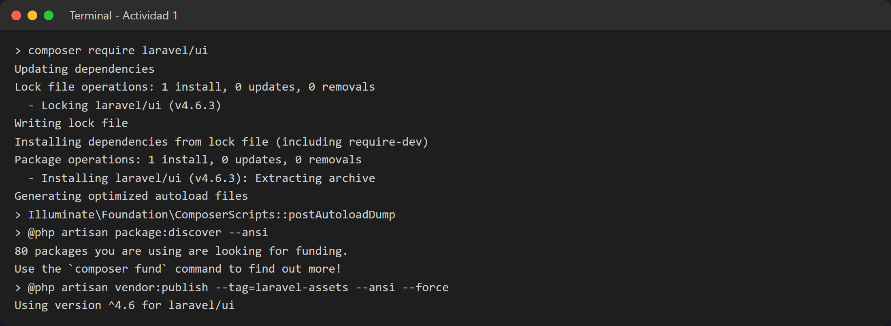

<!-- CAPTURA generada por automatizar/lab11.js: act1_03_ui-auth.png -->
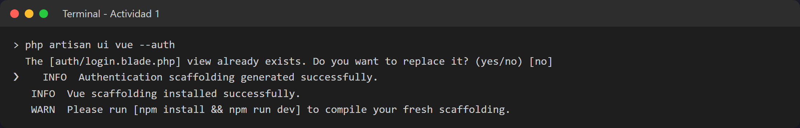

El comando `ui vue --auth` instala el scaffolding de Vue.js y genera el `HomeController`, las vistas de `resources/views/auth/` y la ruta `Auth::routes()`. (Las alternativas son `ui react --auth` y `ui bootstrap --auth`.)

Según la guía, se modificó `routes/web.php` para utilizar los controladores generados:


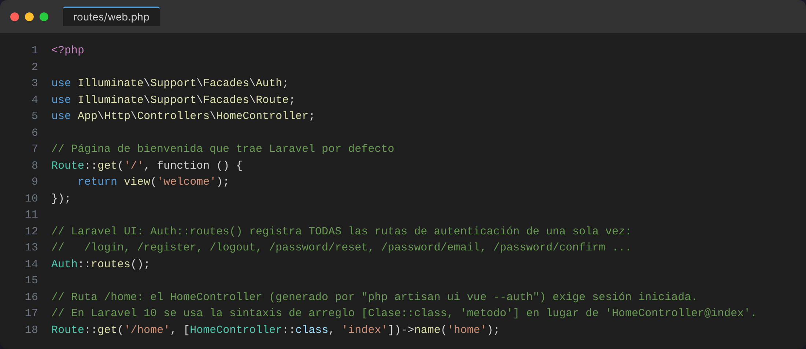

<details><summary>Ver código: <code>routes/web.php</code></summary>

```php
<?php

use Illuminate\Support\Facades\Auth;
use Illuminate\Support\Facades\Route;
use App\Http\Controllers\HomeController;

// Página de bienvenida que trae Laravel por defecto
Route::get('/', function () {
    return view('welcome');
});

// Laravel UI: Auth::routes() registra TODAS las rutas de autenticación de una sola vez:
//   /login, /register, /logout, /password/reset, /password/email, /password/confirm ...
Auth::routes();

// Ruta /home: el HomeController (generado por "php artisan ui vue --auth") exige sesión iniciada.
// En Laravel 10 se usa la sintaxis de arreglo [Clase::class, 'metodo'] en lugar de 'HomeController@index'.
Route::get('/home', [HomeController::class, 'index'])->name('home');
```

</details>

`Auth::routes()` registra de una sola vez `/login`, `/register`, `/logout`, `/password/reset`, `/password/email` y `/password/confirm`. La ruta `/home` queda protegida por el `HomeController` generado, que exige sesión iniciada.


<!-- CAPTURA generada por automatizar/lab11.js: act1_04_route-list.png -->
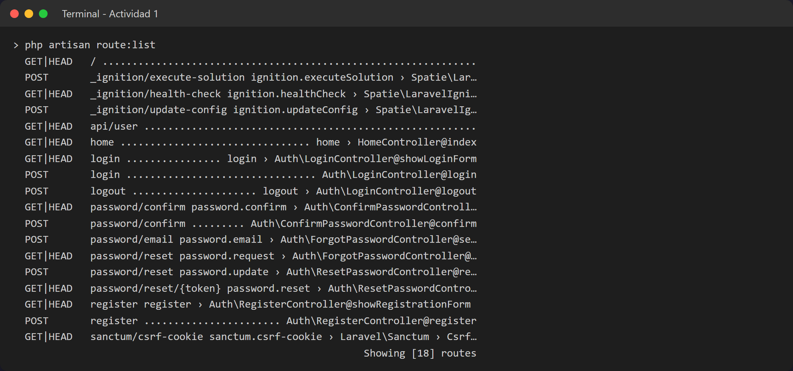

Con `php artisan migrate` se crearon las tablas, entre ellas `users` y `password_reset_tokens`:


<!-- CAPTURA generada por automatizar/lab11.js: act1_05_migrate.png -->
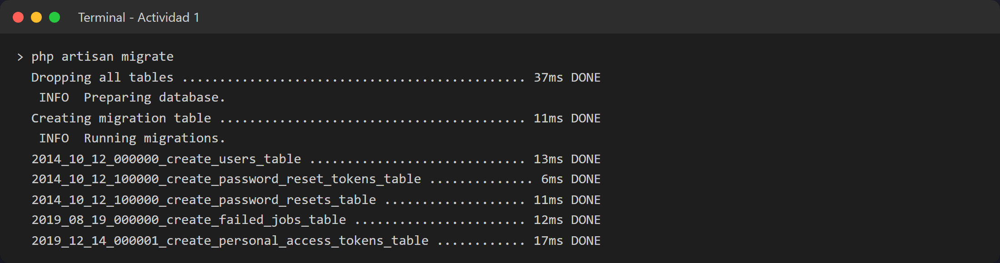

---

### 6.2 Actividad 2: Laravel Breeze — autenticación con credenciales

Breeze es una solución rápida y sencilla para añadir autenticación: genera en la aplicación las rutas, controladores y vistas Blade, de modo que el código queda disponible para modificarlo libremente.

```bash
composer require laravel/breeze --dev
php artisan breeze:install blade
npm install && npm run build
```


<!-- CAPTURA generada por automatizar/lab11.js: act2_03_composer-require.png -->
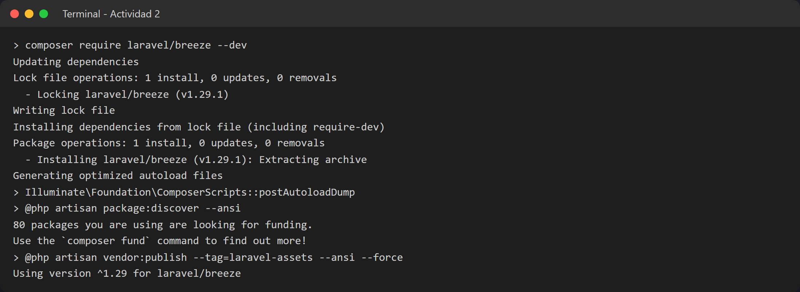

<!-- CAPTURA generada por automatizar/lab11.js: act2_04_breeze-install.png -->
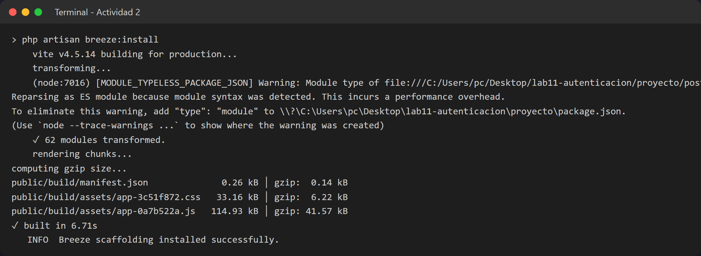

Breeze crea `routes/auth.php` (login, registro, recuperar contraseña, verificar correo y confirmar contraseña), los controladores de `app/Http/Controllers/Auth`, las vistas de `resources/views/auth` y el panel (`dashboard`). `routes/web.php` queda así:


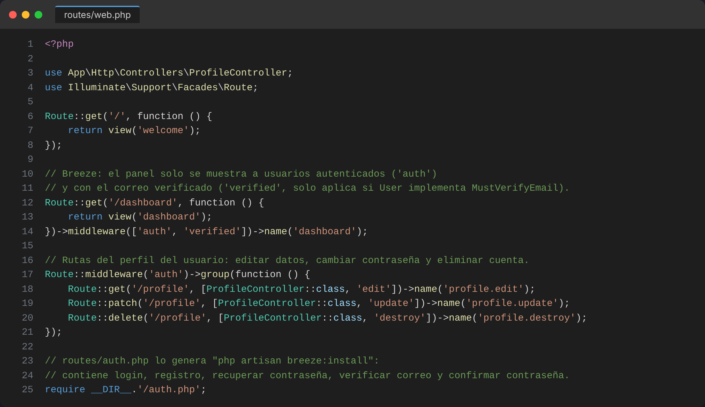

<details><summary>Ver código: <code>routes/web.php</code></summary>

```php
<?php

use App\Http\Controllers\ProfileController;
use Illuminate\Support\Facades\Route;

Route::get('/', function () {
    return view('welcome');
});

// Breeze: el panel solo se muestra a usuarios autenticados ('auth')
// y con el correo verificado ('verified', solo aplica si User implementa MustVerifyEmail).
Route::get('/dashboard', function () {
    return view('dashboard');
})->middleware(['auth', 'verified'])->name('dashboard');

// Rutas del perfil del usuario: editar datos, cambiar contraseña y eliminar cuenta.
Route::middleware('auth')->group(function () {
    Route::get('/profile', [ProfileController::class, 'edit'])->name('profile.edit');
    Route::patch('/profile', [ProfileController::class, 'update'])->name('profile.update');
    Route::delete('/profile', [ProfileController::class, 'destroy'])->name('profile.destroy');
});

// routes/auth.php lo genera "php artisan breeze:install":
// contiene login, registro, recuperar contraseña, verificar correo y confirmar contraseña.
require __DIR__.'/auth.php';
```

</details>

Para exigir la verificación del correo se implementó la interfaz `MustVerifyEmail` en el modelo `User`:


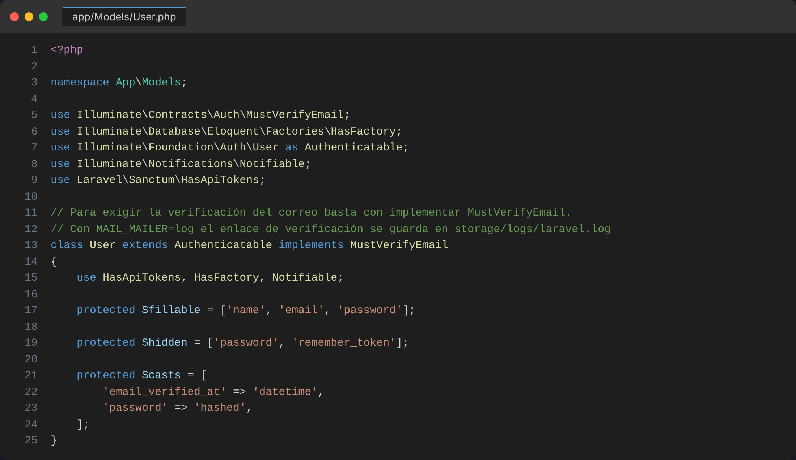

<details><summary>Ver código: <code>app/Models/User.php</code></summary>

```php
<?php

namespace App\Models;

use Illuminate\Contracts\Auth\MustVerifyEmail;
use Illuminate\Database\Eloquent\Factories\HasFactory;
use Illuminate\Foundation\Auth\User as Authenticatable;
use Illuminate\Notifications\Notifiable;
use Laravel\Sanctum\HasApiTokens;

// Para exigir la verificación del correo basta con implementar MustVerifyEmail.
// Con MAIL_MAILER=log el enlace de verificación se guarda en storage/logs/laravel.log
class User extends Authenticatable implements MustVerifyEmail
{
    use HasApiTokens, HasFactory, Notifiable;

    protected $fillable = ['name', 'email', 'password'];

    protected $hidden = ['password', 'remember_token'];

    protected $casts = [
        'email_verified_at' => 'datetime',
        'password' => 'hashed',
    ];
}
```

</details>

Si se desea personalizar las vistas de autenticación, se hace modificando los archivos de `resources/views/auth`. Como `MAIL_MAILER=log`, el correo de verificación se guarda en `storage/logs/laravel.log`, de donde se tomó el enlace de verificación.


---

### 6.3 Actividad 3: Laravel Socialite — autenticación con servicios externos

Socialite permite iniciar sesión con redes sociales (Facebook, Twitter y Google) sin crear una cuenta propia. Se partió del login de Breeze (rama `act2-breeze`) para agregarle los botones.

```bash
composer require laravel/socialite
```


<!-- CAPTURA generada por automatizar/lab11.js: act3_09_composer-require.png -->
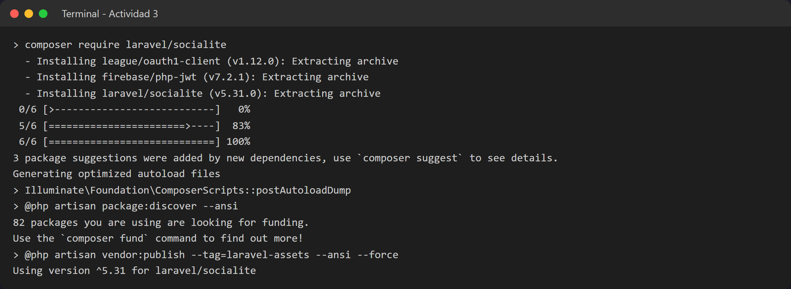

**Claves en `.env` y `config/services.php`.** Cada red social necesita su `CLIENT_ID`, `CLIENT_SECRET` y `REDIRECT_URI`, que se obtienen en el panel de desarrolladores de cada una (en las capturas se usan valores de ejemplo):


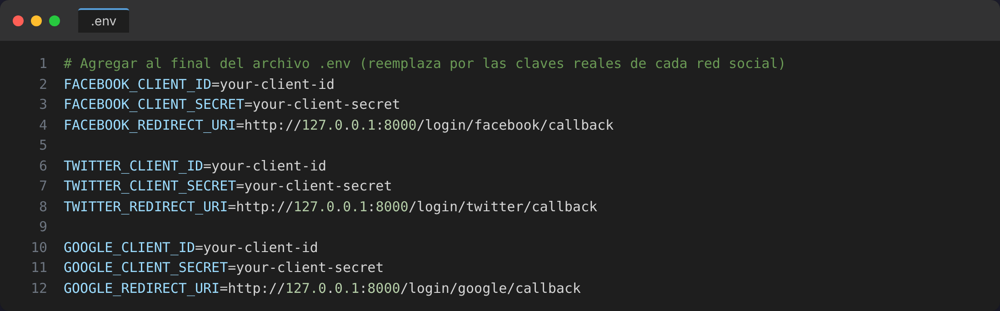

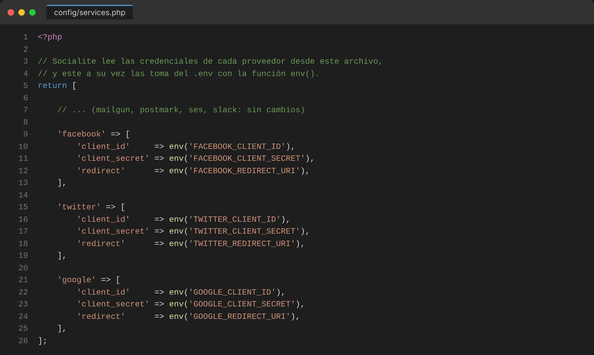

<details><summary>Ver código: <code>config/services.php</code></summary>

```php
<?php

// Socialite lee las credenciales de cada proveedor desde este archivo,
// y este a su vez las toma del .env con la función env().
return [

    // ... (mailgun, postmark, ses, slack: sin cambios)

    'facebook' => [
        'client_id'     => env('FACEBOOK_CLIENT_ID'),
        'client_secret' => env('FACEBOOK_CLIENT_SECRET'),
        'redirect'      => env('FACEBOOK_REDIRECT_URI'),
    ],

    'twitter' => [
        'client_id'     => env('TWITTER_CLIENT_ID'),
        'client_secret' => env('TWITTER_CLIENT_SECRET'),
        'redirect'      => env('TWITTER_REDIRECT_URI'),
    ],

    'google' => [
        'client_id'     => env('GOOGLE_CLIENT_ID'),
        'client_secret' => env('GOOGLE_CLIENT_SECRET'),
        'redirect'      => env('GOOGLE_REDIRECT_URI'),
    ],
];
```

</details>

**Controlador.** Se creó con `php artisan make:controller SocialAuthController`. El método `redirectToProvider` envía al usuario a la red social y `handleProviderCallback` recibe sus datos, crea o vincula el usuario y abre la sesión:


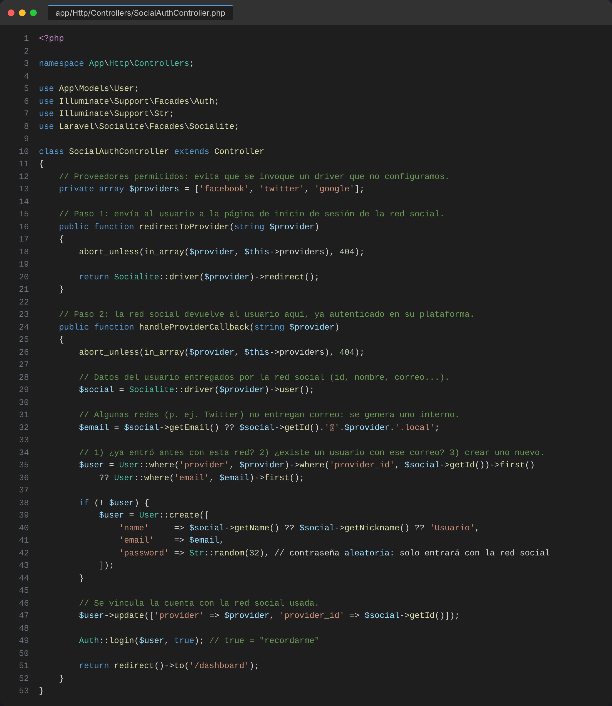

<details><summary>Ver código: <code>app/Http/Controllers/SocialAuthController.php</code></summary>

```php
<?php

namespace App\Http\Controllers;

use App\Models\User;
use Illuminate\Support\Facades\Auth;
use Illuminate\Support\Str;
use Laravel\Socialite\Facades\Socialite;

class SocialAuthController extends Controller
{
    // Proveedores permitidos: evita que se invoque un driver que no configuramos.
    private array $providers = ['facebook', 'twitter', 'google'];

    // Paso 1: envía al usuario a la página de inicio de sesión de la red social.
    public function redirectToProvider(string $provider)
    {
        abort_unless(in_array($provider, $this->providers), 404);

        return Socialite::driver($provider)->redirect();
    }

    // Paso 2: la red social devuelve al usuario aquí, ya autenticado en su plataforma.
    public function handleProviderCallback(string $provider)
    {
        abort_unless(in_array($provider, $this->providers), 404);

        // Datos del usuario entregados por la red social (id, nombre, correo...).
        $social = Socialite::driver($provider)->user();

        // Algunas redes (p. ej. Twitter) no entregan correo: se genera uno interno.
        $email = $social->getEmail() ?? $social->getId().'@'.$provider.'.local';

        // 1) ¿ya entró antes con esta red? 2) ¿existe un usuario con ese correo? 3) crear uno nuevo.
        $user = User::where('provider', $provider)->where('provider_id', $social->getId())->first()
            ?? User::where('email', $email)->first();

        if (! $user) {
            $user = User::create([
                'name'     => $social->getName() ?? $social->getNickname() ?? 'Usuario',
                'email'    => $email,
                'password' => Str::random(32), // contraseña aleatoria: solo entrará con la red social
            ]);
        }

        // Se vincula la cuenta con la red social usada.
        $user->update(['provider' => $provider, 'provider_id' => $social->getId()]);

        Auth::login($user, true); // true = "recordarme"

        return redirect()->to('/dashboard');
    }
}
```

</details>

**Rutas.** Se agregaron `login/{provider}` y `login/{provider}/callback`:


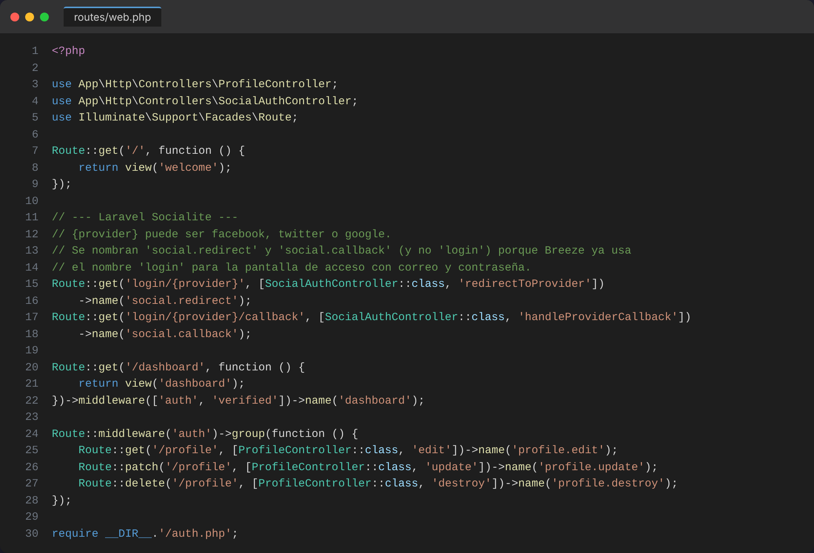

<details><summary>Ver código: <code>routes/web.php</code></summary>

```php
<?php

use App\Http\Controllers\ProfileController;
use App\Http\Controllers\SocialAuthController;
use Illuminate\Support\Facades\Route;

Route::get('/', function () {
    return view('welcome');
});

// --- Laravel Socialite ---
// {provider} puede ser facebook, twitter o google.
// Se nombran 'social.redirect' y 'social.callback' (y no 'login') porque Breeze ya usa
// el nombre 'login' para la pantalla de acceso con correo y contraseña.
Route::get('login/{provider}', [SocialAuthController::class, 'redirectToProvider'])
    ->name('social.redirect');
Route::get('login/{provider}/callback', [SocialAuthController::class, 'handleProviderCallback'])
    ->name('social.callback');

Route::get('/dashboard', function () {
    return view('dashboard');
})->middleware(['auth', 'verified'])->name('dashboard');

Route::middleware('auth')->group(function () {
    Route::get('/profile', [ProfileController::class, 'edit'])->name('profile.edit');
    Route::patch('/profile', [ProfileController::class, 'update'])->name('profile.update');
    Route::delete('/profile', [ProfileController::class, 'destroy'])->name('profile.destroy');
});

require __DIR__.'/auth.php';
```

</details>

**Base de datos y modelo.** Para guardar con qué red social se registró cada usuario se agregaron las columnas `provider` y `provider_id`:


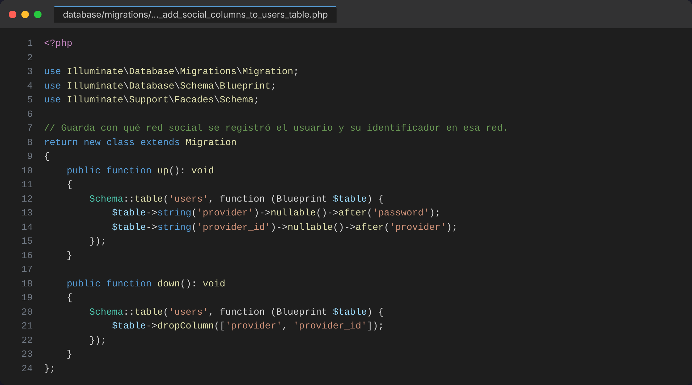

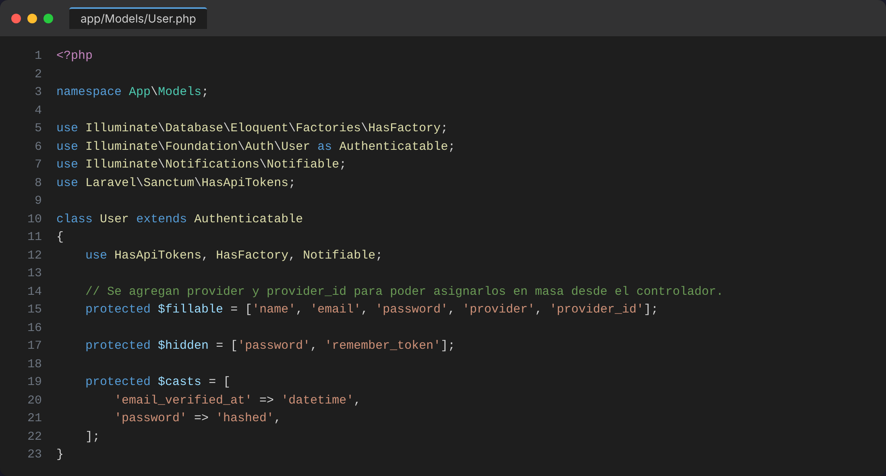

<details><summary>Ver código: <code>migración</code></summary>

```php
<?php

use Illuminate\Database\Migrations\Migration;
use Illuminate\Database\Schema\Blueprint;
use Illuminate\Support\Facades\Schema;

// Guarda con qué red social se registró el usuario y su identificador en esa red.
return new class extends Migration
{
    public function up(): void
    {
        Schema::table('users', function (Blueprint $table) {
            $table->string('provider')->nullable()->after('password');
            $table->string('provider_id')->nullable()->after('provider');
        });
    }

    public function down(): void
    {
        Schema::table('users', function (Blueprint $table) {
            $table->dropColumn(['provider', 'provider_id']);
        });
    }
};
```

</details>
<details><summary>Ver código: <code>app/Models/User.php</code></summary>

```php
<?php

namespace App\Models;

use Illuminate\Database\Eloquent\Factories\HasFactory;
use Illuminate\Foundation\Auth\User as Authenticatable;
use Illuminate\Notifications\Notifiable;
use Laravel\Sanctum\HasApiTokens;

class User extends Authenticatable
{
    use HasApiTokens, HasFactory, Notifiable;

    // Se agregan provider y provider_id para poder asignarlos en masa desde el controlador.
    protected $fillable = ['name', 'email', 'password', 'provider', 'provider_id'];

    protected $hidden = ['password', 'remember_token'];

    protected $casts = [
        'email_verified_at' => 'datetime',
        'password' => 'hashed',
    ];
}
```

</details>

<!-- CAPTURA generada por automatizar/lab11.js: act3_10_migrate.png -->
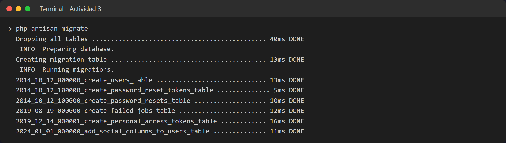

**Botones.** Los enlaces se crean con el método `route` de Laravel y se incluyen en la vista de login de Breeze:


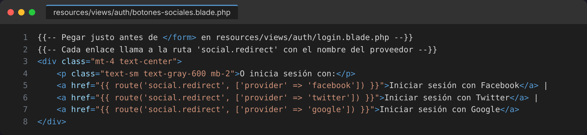

<details><summary>Ver código: <code>botones-sociales.blade.php</code></summary>

```html
{{-- Pegar justo antes de </form> en resources/views/auth/login.blade.php --}}
{{-- Cada enlace llama a la ruta 'social.redirect' con el nombre del proveedor --}}
<div class="mt-4 text-center">
    <p class="text-sm text-gray-600 mb-2">O inicia sesión con:</p>
    <a href="{{ route('social.redirect', ['provider' => 'facebook']) }}">Iniciar sesión con Facebook</a> |
    <a href="{{ route('social.redirect', ['provider' => 'twitter']) }}">Iniciar sesión con Twitter</a> |
    <a href="{{ route('social.redirect', ['provider' => 'google']) }}">Iniciar sesión con Google</a>
</div>
```

</details>

**Prueba del flujo.** Como el inicio de sesión real requiere claves de cada red social, el flujo del callback se comprobó con una prueba automatizada que simula la respuesta de Google (`Socialite::shouldReceive`), verificando que se crea el usuario, que queda autenticado y que se guardan `provider` y `provider_id`:


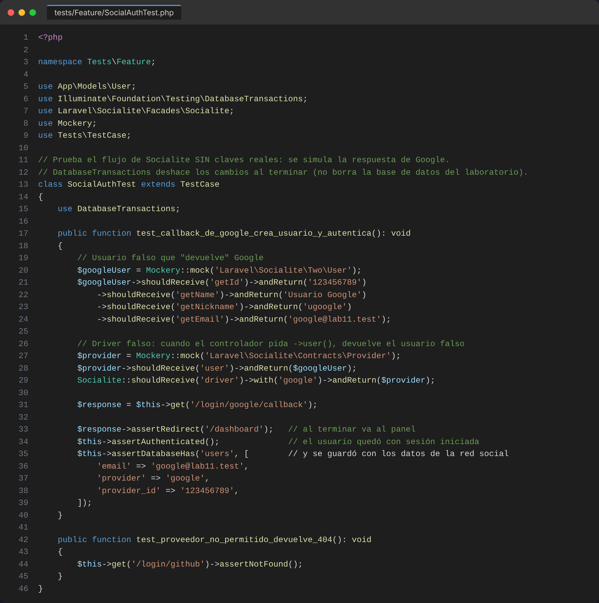

<details><summary>Ver código: <code>tests/Feature/SocialAuthTest.php</code></summary>

```php
<?php

namespace Tests\Feature;

use App\Models\User;
use Illuminate\Foundation\Testing\DatabaseTransactions;
use Laravel\Socialite\Facades\Socialite;
use Mockery;
use Tests\TestCase;

// Prueba el flujo de Socialite SIN claves reales: se simula la respuesta de Google.
// DatabaseTransactions deshace los cambios al terminar (no borra la base de datos del laboratorio).
class SocialAuthTest extends TestCase
{
    use DatabaseTransactions;

    public function test_callback_de_google_crea_usuario_y_autentica(): void
    {
        // Usuario falso que "devuelve" Google
        $googleUser = Mockery::mock('Laravel\Socialite\Two\User');
        $googleUser->shouldReceive('getId')->andReturn('123456789')
            ->shouldReceive('getName')->andReturn('Usuario Google')
            ->shouldReceive('getNickname')->andReturn('ugoogle')
            ->shouldReceive('getEmail')->andReturn('google@lab11.test');

        // Driver falso: cuando el controlador pida ->user(), devuelve el usuario falso
        $provider = Mockery::mock('Laravel\Socialite\Contracts\Provider');
        $provider->shouldReceive('user')->andReturn($googleUser);
        Socialite::shouldReceive('driver')->with('google')->andReturn($provider);

        $response = $this->get('/login/google/callback');

        $response->assertRedirect('/dashboard');   // al terminar va al panel
        $this->assertAuthenticated();              // el usuario quedó con sesión iniciada
        $this->assertDatabaseHas('users', [        // y se guardó con los datos de la red social
            'email' => 'google@lab11.test',
            'provider' => 'google',
            'provider_id' => '123456789',
        ]);
    }

    public function test_proveedor_no_permitido_devuelve_404(): void
    {
        $this->get('/login/github')->assertNotFound();
    }
}
```

</details>

<!-- CAPTURA generada por automatizar/lab11.js: act3_13_test.png -->
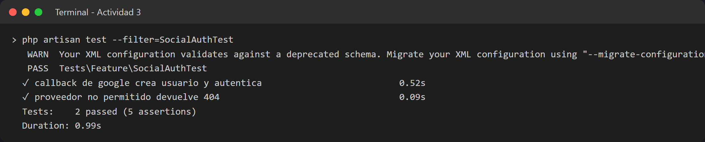

---

### 6.4 Actividad 4: Laravel Passport — autenticación con tokens

Passport implementa OAuth2 para dar acceso seguro a la API de la aplicación.

```bash
composer require laravel/passport:^11.0
php artisan migrate
php artisan passport:install
```


<!-- CAPTURA generada por automatizar/lab11.js: act4_05_composer-require.png -->
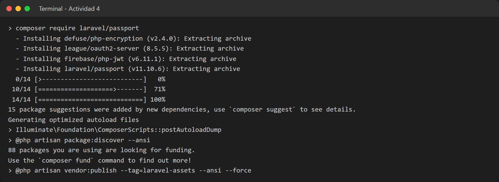

`php artisan migrate` crea las tablas necesarias para los tokens: `oauth_auth_codes`, `oauth_access_tokens`, `oauth_refresh_tokens`, `oauth_clients` y `oauth_personal_access_clients`:


<!-- CAPTURA generada por automatizar/lab11.js: act4_06_migrate.png -->
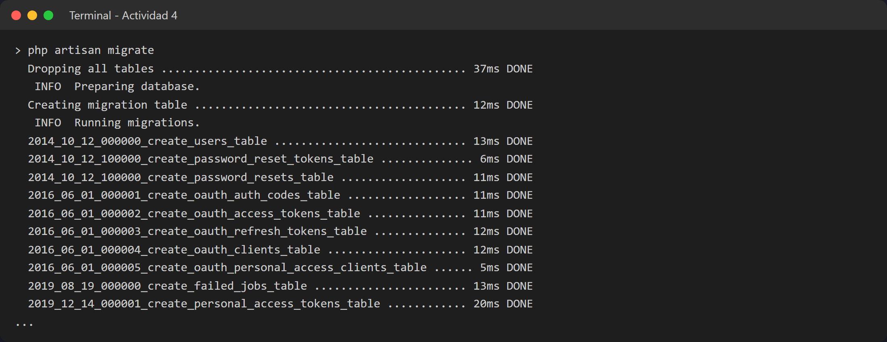

`php artisan passport:install` genera las llaves de encriptación y crea el *Personal access client* y el *Password grant client* (los secretos se ocultan en la captura):


<!-- CAPTURA generada por automatizar/lab11.js: act4_07_passport-install.png -->
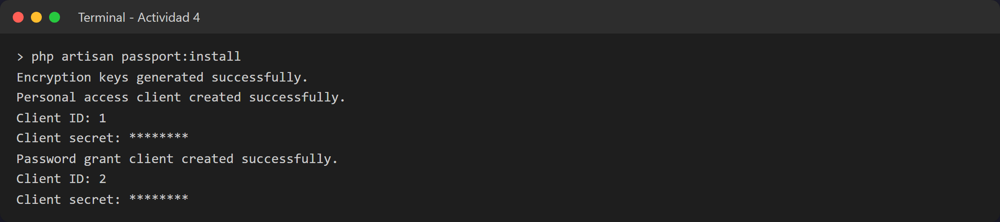

Se agregó el trait `HasApiTokens` de Passport al modelo `User`:


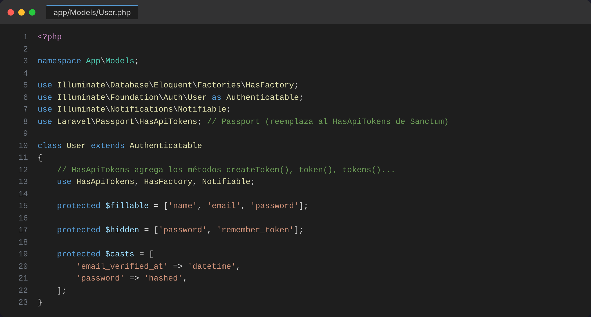

<details><summary>Ver código: <code>app/Models/User.php</code></summary>

```php
<?php

namespace App\Models;

use Illuminate\Database\Eloquent\Factories\HasFactory;
use Illuminate\Foundation\Auth\User as Authenticatable;
use Illuminate\Notifications\Notifiable;
use Laravel\Passport\HasApiTokens; // Passport (reemplaza al HasApiTokens de Sanctum)

class User extends Authenticatable
{
    // HasApiTokens agrega los métodos createToken(), token(), tokens()...
    use HasApiTokens, HasFactory, Notifiable;

    protected $fillable = ['name', 'email', 'password'];

    protected $hidden = ['password', 'remember_token'];

    protected $casts = [
        'email_verified_at' => 'datetime',
        'password' => 'hashed',
    ];
}
```

</details>

En `config/auth.php` se definió el guard `api` con el driver `passport`, para que la aplicación use el `TokenGuard` de Passport en las solicitudes de la API:


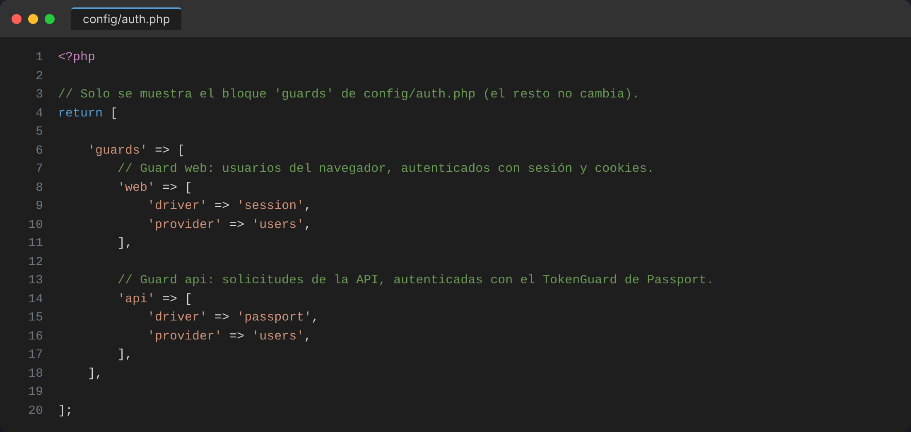

<details><summary>Ver código: <code>config/auth.php (guards)</code></summary>

```php
<?php

// Solo se muestra el bloque 'guards' de config/auth.php (el resto no cambia).
return [

    'guards' => [
        // Guard web: usuarios del navegador, autenticados con sesión y cookies.
        'web' => [
            'driver' => 'session',
            'provider' => 'users',
        ],

        // Guard api: solicitudes de la API, autenticadas con el TokenGuard de Passport.
        'api' => [
            'driver' => 'passport',
            'provider' => 'users',
        ],
    ],

];
```

</details>

Para probar la autenticación se creó un controlador con `register`, `login` y `logout`, y las rutas de `routes/api.php`, donde las protegidas usan el middleware `auth:api`:


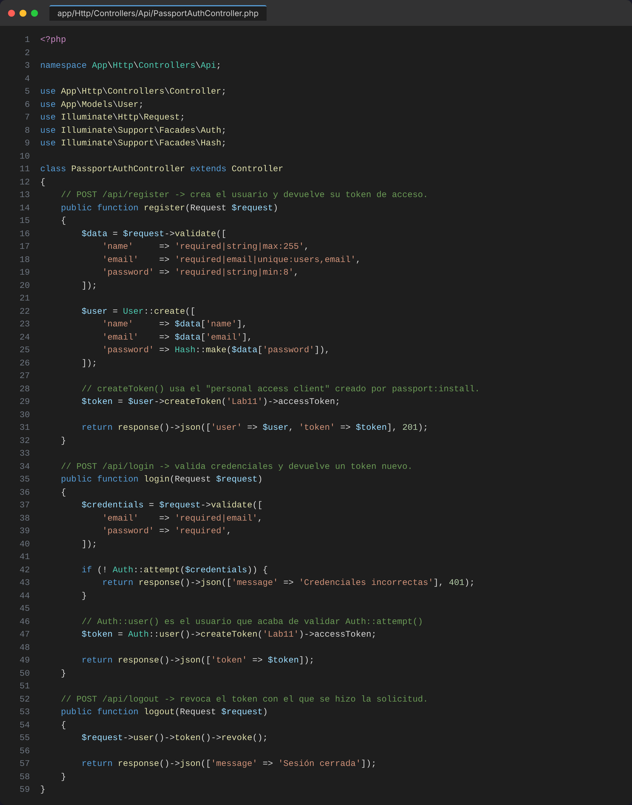

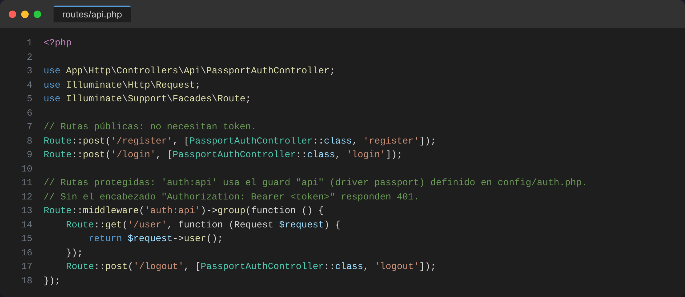

<details><summary>Ver código: <code>PassportAuthController.php</code></summary>

```php
<?php

namespace App\Http\Controllers\Api;

use App\Http\Controllers\Controller;
use App\Models\User;
use Illuminate\Http\Request;
use Illuminate\Support\Facades\Auth;
use Illuminate\Support\Facades\Hash;

class PassportAuthController extends Controller
{
    // POST /api/register -> crea el usuario y devuelve su token de acceso.
    public function register(Request $request)
    {
        $data = $request->validate([
            'name'     => 'required|string|max:255',
            'email'    => 'required|email|unique:users,email',
            'password' => 'required|string|min:8',
        ]);

        $user = User::create([
            'name'     => $data['name'],
            'email'    => $data['email'],
            'password' => Hash::make($data['password']),
        ]);

        // createToken() usa el "personal access client" creado por passport:install.
        $token = $user->createToken('Lab11')->accessToken;

        return response()->json(['user' => $user, 'token' => $token], 201);
    }

    // POST /api/login -> valida credenciales y devuelve un token nuevo.
    public function login(Request $request)
    {
        $credentials = $request->validate([
            'email'    => 'required|email',
            'password' => 'required',
        ]);

        if (! Auth::attempt($credentials)) {
            return response()->json(['message' => 'Credenciales incorrectas'], 401);
        }

        // Auth::user() es el usuario que acaba de validar Auth::attempt()
        $token = Auth::user()->createToken('Lab11')->accessToken;

        return response()->json(['token' => $token]);
    }

    // POST /api/logout -> revoca el token con el que se hizo la solicitud.
    public function logout(Request $request)
    {
        $request->user()->token()->revoke();

        return response()->json(['message' => 'Sesión cerrada']);
    }
}
```

</details>
<details><summary>Ver código: <code>routes/api.php</code></summary>

```php
<?php

use App\Http\Controllers\Api\PassportAuthController;
use Illuminate\Http\Request;
use Illuminate\Support\Facades\Route;

// Rutas públicas: no necesitan token.
Route::post('/register', [PassportAuthController::class, 'register']);
Route::post('/login', [PassportAuthController::class, 'login']);

// Rutas protegidas: 'auth:api' usa el guard "api" (driver passport) definido en config/auth.php.
// Sin el encabezado "Authorization: Bearer <token>" responden 401.
Route::middleware('auth:api')->group(function () {
    Route::get('/user', function (Request $request) {
        return $request->user();
    });
    Route::post('/logout', [PassportAuthController::class, 'logout']);
});
```

</details>

**¿Passport o Sanctum?** Passport se usa si la aplicación necesita OAuth2 completo. Para una aplicación de una sola página, una aplicación móvil o para emitir tokens de API simples, es preferible Laravel Sanctum, que no es compatible con OAuth2 pero es mucho más simple.


---

### 6.5 Actividad 5: Laravel Fortify — autenticación backend

Fortify incluye controladores y rutas predefinidas para la autenticación y el registro de usuarios, pero **no incluye el front-end**: las vistas las define el desarrollador.

```bash
composer require laravel/fortify
php artisan vendor:publish --provider="Laravel\Fortify\FortifyServiceProvider"
```


<!-- CAPTURA generada por automatizar/lab11.js: act5_07_composer-require.png -->
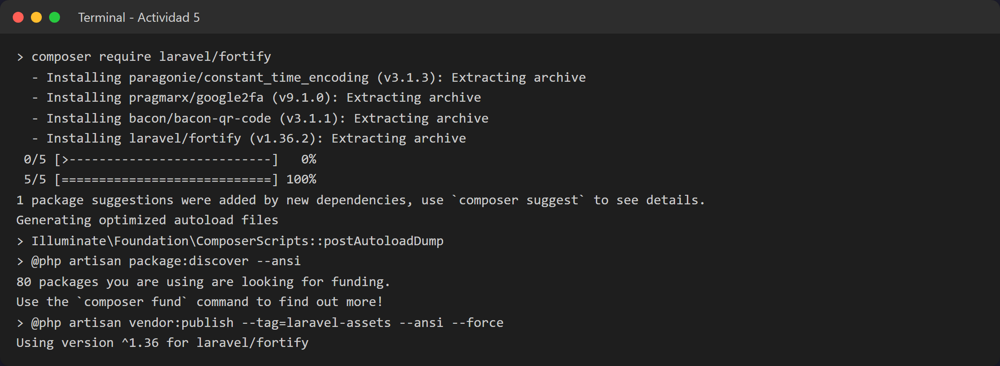

<!-- CAPTURA generada por automatizar/lab11.js: act5_08_vendor-publish.png -->
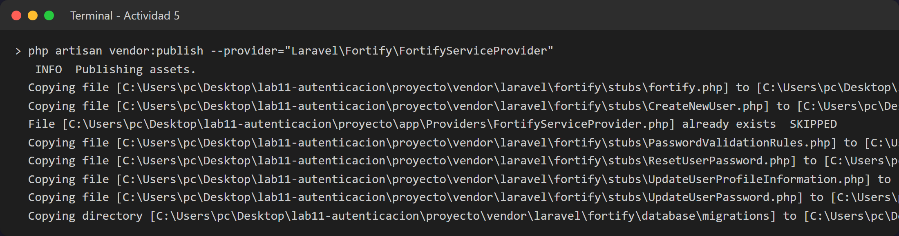

*Publica app/Actions/Fortify, FortifyServiceProvider, config/fortify.php y la migración de las columnas de dos factores.*

Se registró el provider en el arreglo `providers` de `config/app.php`:


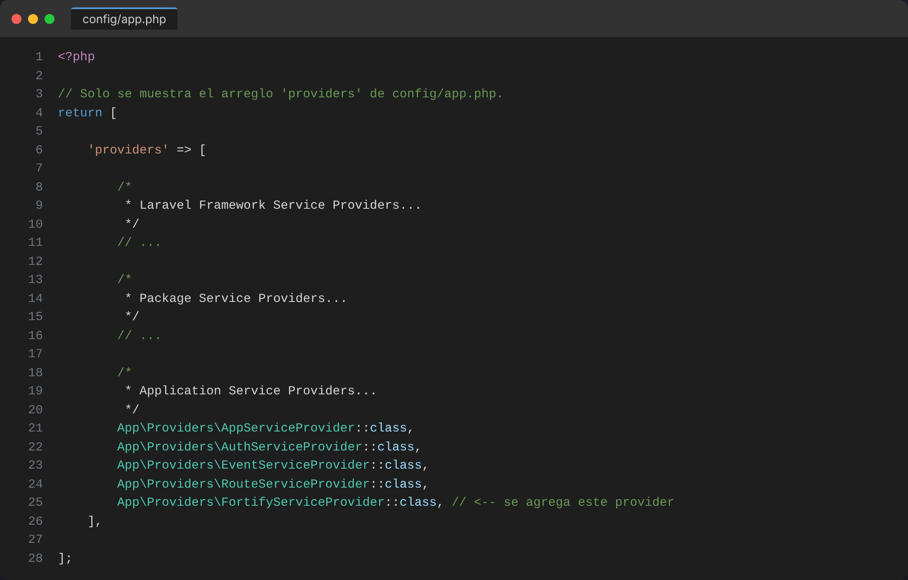

<details><summary>Ver código: <code>config/app.php (providers)</code></summary>

```php
<?php

// Solo se muestra el arreglo 'providers' de config/app.php.
return [

    'providers' => [

        /*
         * Laravel Framework Service Providers...
         */
        // ...

        /*
         * Package Service Providers...
         */
        // ...

        /*
         * Application Service Providers...
         */
        App\Providers\AppServiceProvider::class,
        App\Providers\AuthServiceProvider::class,
        App\Providers\EventServiceProvider::class,
        App\Providers\RouteServiceProvider::class,
        App\Providers\FortifyServiceProvider::class, // <-- se agrega este provider
    ],

];
```

</details>

En `FortifyServiceProvider` se indica a Fortify dónde están los archivos de vista de cada proceso (login, registro, recuperar contraseña, restablecer, confirmar contraseña y desafío de dos factores). Como alternativa, `Fortify::viewPrefix('auth.')` los busca automáticamente. También se definieron los límites de intentos de acceso:


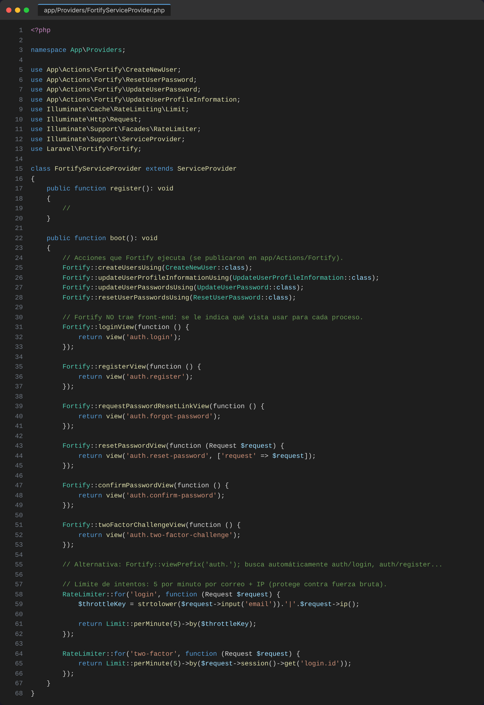

<details><summary>Ver código: <code>app/Providers/FortifyServiceProvider.php</code></summary>

```php
<?php

namespace App\Providers;

use App\Actions\Fortify\CreateNewUser;
use App\Actions\Fortify\ResetUserPassword;
use App\Actions\Fortify\UpdateUserPassword;
use App\Actions\Fortify\UpdateUserProfileInformation;
use Illuminate\Cache\RateLimiting\Limit;
use Illuminate\Http\Request;
use Illuminate\Support\Facades\RateLimiter;
use Illuminate\Support\ServiceProvider;
use Laravel\Fortify\Fortify;

class FortifyServiceProvider extends ServiceProvider
{
    public function register(): void
    {
        //
    }

    public function boot(): void
    {
        // Acciones que Fortify ejecuta (se publicaron en app/Actions/Fortify).
        Fortify::createUsersUsing(CreateNewUser::class);
        Fortify::updateUserProfileInformationUsing(UpdateUserProfileInformation::class);
        Fortify::updateUserPasswordsUsing(UpdateUserPassword::class);
        Fortify::resetUserPasswordsUsing(ResetUserPassword::class);

        // Fortify NO trae front-end: se le indica qué vista usar para cada proceso.
        Fortify::loginView(function () {
            return view('auth.login');
        });

        Fortify::registerView(function () {
            return view('auth.register');
        });

        Fortify::requestPasswordResetLinkView(function () {
            return view('auth.forgot-password');
        });

        Fortify::resetPasswordView(function (Request $request) {
            return view('auth.reset-password', ['request' => $request]);
        });

        Fortify::confirmPasswordView(function () {
            return view('auth.confirm-password');
        });

        Fortify::twoFactorChallengeView(function () {
            return view('auth.two-factor-challenge');
        });

        // Alternativa: Fortify::viewPrefix('auth.'); busca automáticamente auth/login, auth/register...

        // Límite de intentos: 5 por minuto por correo + IP (protege contra fuerza bruta).
        RateLimiter::for('login', function (Request $request) {
            $throttleKey = strtolower($request->input('email')).'|'.$request->ip();

            return Limit::perMinute(5)->by($throttleKey);
        });

        RateLimiter::for('two-factor', function (Request $request) {
            return Limit::perMinute(5)->by($request->session()->get('login.id'));
        });
    }
}
```

</details>

Después se creó cada archivo de vista con su formulario (en `resources/views/auth/`), usando Bootstrap desde CDN, y la vista `home`. Ejemplo, el formulario de login que envía a `POST /login` (ruta de Fortify):


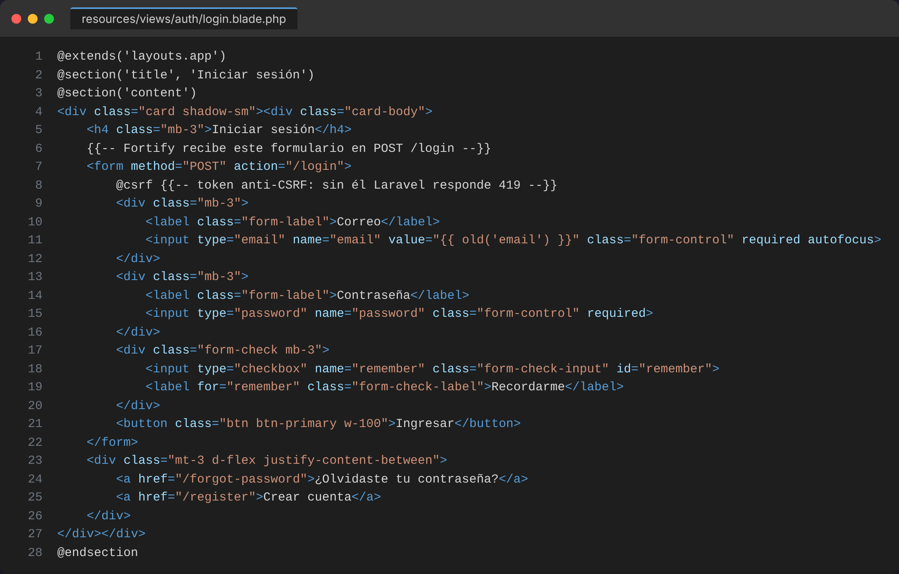

<details><summary>Ver código: <code>resources/views/auth/login.blade.php</code></summary>

```html
@extends('layouts.app')
@section('title', 'Iniciar sesión')
@section('content')
<div class="card shadow-sm"><div class="card-body">
    <h4 class="mb-3">Iniciar sesión</h4>
    {{-- Fortify recibe este formulario en POST /login --}}
    <form method="POST" action="/login">
        @csrf {{-- token anti-CSRF: sin él Laravel responde 419 --}}
        <div class="mb-3">
            <label class="form-label">Correo</label>
            <input type="email" name="email" value="{{ old('email') }}" class="form-control" required autofocus>
        </div>
        <div class="mb-3">
            <label class="form-label">Contraseña</label>
            <input type="password" name="password" class="form-control" required>
        </div>
        <div class="form-check mb-3">
            <input type="checkbox" name="remember" class="form-check-input" id="remember">
            <label for="remember" class="form-check-label">Recordarme</label>
        </div>
        <button class="btn btn-primary w-100">Ingresar</button>
    </form>
    <div class="mt-3 d-flex justify-content-between">
        <a href="/forgot-password">¿Olvidaste tu contraseña?</a>
        <a href="/register">Crear cuenta</a>
    </div>
</div></div>
@endsection
```

</details>

La vista `home` permite **activar la autenticación en dos pasos (2FA)**: muestra el código QR para escanear con una aplicación autenticadora, pide confirmar con un código y muestra los códigos de recuperación. Para ello el modelo `User` usa el trait `TwoFactorAuthenticatable`:


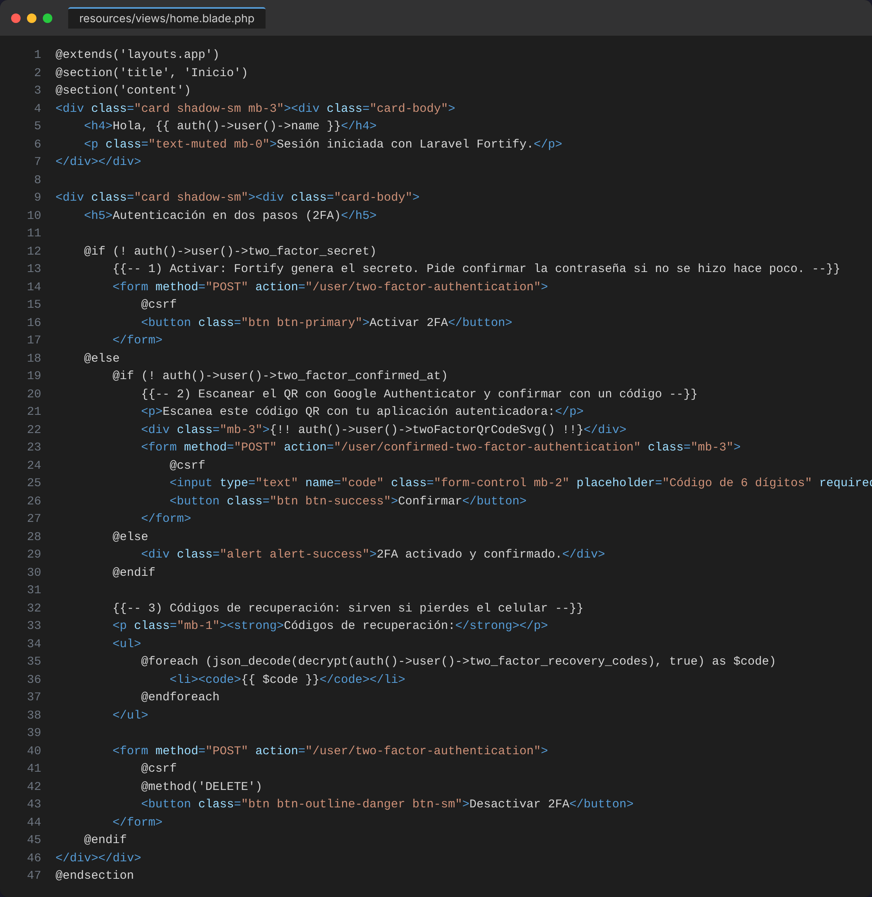

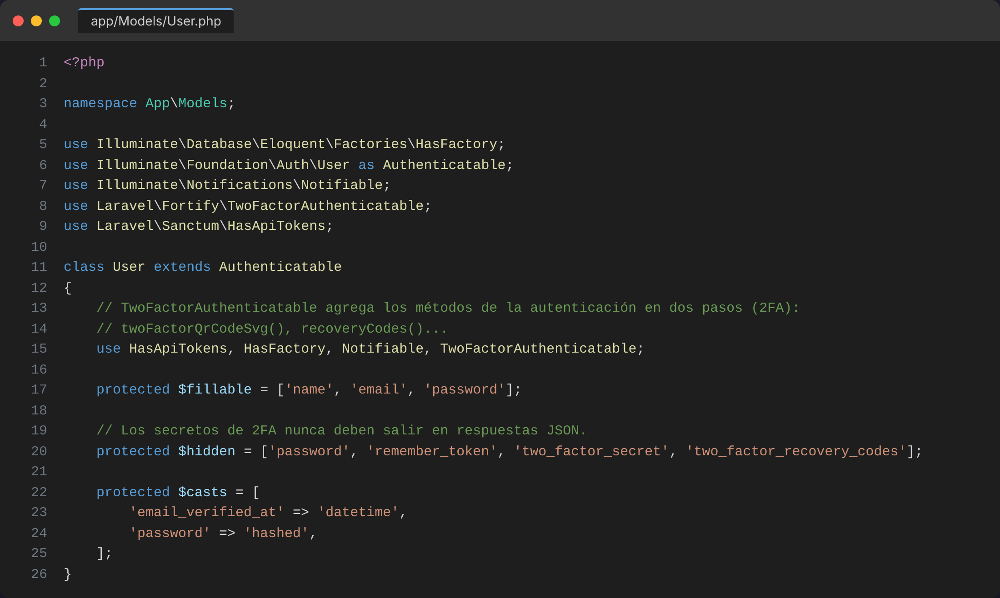

<details><summary>Ver código: <code>resources/views/home.blade.php</code></summary>

```html
@extends('layouts.app')
@section('title', 'Inicio')
@section('content')
<div class="card shadow-sm mb-3"><div class="card-body">
    <h4>Hola, {{ auth()->user()->name }}</h4>
    <p class="text-muted mb-0">Sesión iniciada con Laravel Fortify.</p>
</div></div>

<div class="card shadow-sm"><div class="card-body">
    <h5>Autenticación en dos pasos (2FA)</h5>

    @if (! auth()->user()->two_factor_secret)
        {{-- 1) Activar: Fortify genera el secreto. Pide confirmar la contraseña si no se hizo hace poco. --}}
        <form method="POST" action="/user/two-factor-authentication">
            @csrf
            <button class="btn btn-primary">Activar 2FA</button>
        </form>
    @else
        @if (! auth()->user()->two_factor_confirmed_at)
            {{-- 2) Escanear el QR con Google Authenticator y confirmar con un código --}}
            <p>Escanea este código QR con tu aplicación autenticadora:</p>
            <div class="mb-3">{!! auth()->user()->twoFactorQrCodeSvg() !!}</div>
            <form method="POST" action="/user/confirmed-two-factor-authentication" class="mb-3">
                @csrf
                <input type="text" name="code" class="form-control mb-2" placeholder="Código de 6 dígitos" required>
                <button class="btn btn-success">Confirmar</button>
            </form>
        @else
            <div class="alert alert-success">2FA activado y confirmado.</div>
        @endif

        {{-- 3) Códigos de recuperación: sirven si pierdes el celular --}}
        <p class="mb-1"><strong>Códigos de recuperación:</strong></p>
        <ul>
            @foreach (json_decode(decrypt(auth()->user()->two_factor_recovery_codes), true) as $code)
                <li><code>{{ $code }}</code></li>
            @endforeach
        </ul>

        <form method="POST" action="/user/two-factor-authentication">
            @csrf
            @method('DELETE')
            <button class="btn btn-outline-danger btn-sm">Desactivar 2FA</button>
        </form>
    @endif
</div></div>
@endsection
```

</details>
<details><summary>Ver código: <code>app/Models/User.php</code></summary>

```php
<?php

namespace App\Models;

use Illuminate\Database\Eloquent\Factories\HasFactory;
use Illuminate\Foundation\Auth\User as Authenticatable;
use Illuminate\Notifications\Notifiable;
use Laravel\Fortify\TwoFactorAuthenticatable;
use Laravel\Sanctum\HasApiTokens;

class User extends Authenticatable
{
    // TwoFactorAuthenticatable agrega los métodos de la autenticación en dos pasos (2FA):
    // twoFactorQrCodeSvg(), recoveryCodes()...
    use HasApiTokens, HasFactory, Notifiable, TwoFactorAuthenticatable;

    protected $fillable = ['name', 'email', 'password'];

    // Los secretos de 2FA nunca deben salir en respuestas JSON.
    protected $hidden = ['password', 'remember_token', 'two_factor_secret', 'two_factor_recovery_codes'];

    protected $casts = [
        'email_verified_at' => 'datetime',
        'password' => 'hashed',
    ];
}
```

</details>
<details><summary>Ver código: <code>routes/web.php</code></summary>

```php
<?php

use Illuminate\Support\Facades\Route;

Route::get('/', function () {
    return view('welcome');
});

// Fortify registra por su cuenta /login, /register, /logout, /forgot-password,
// /reset-password, /user/confirm-password, /two-factor-challenge, /user/two-factor-authentication...
// Aquí solo definimos la página a la que llega el usuario autenticado.
Route::get('/home', function () {
    return view('home');
})->middleware('auth')->name('home');
```

</details>

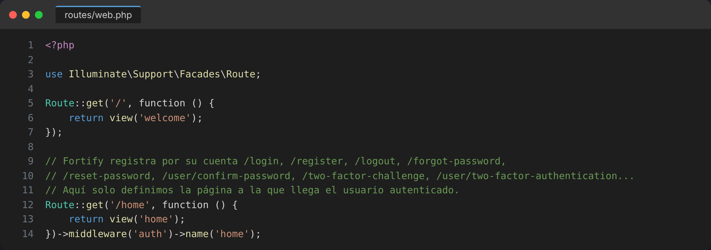


<!-- CAPTURA generada por automatizar/lab11.js: act5_09_migrate.png -->
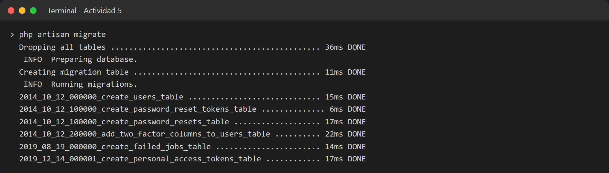

<!-- CAPTURA generada por automatizar/lab11.js: act5_10_route-list.png -->
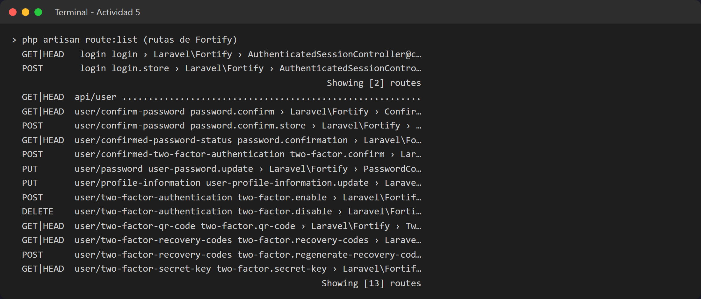

---

## 7. Funcionamiento de las aplicaciones

En esta sección se muestra cada aplicación en ejecución (con `php artisan serve` en `http://127.0.0.1:8000`), siguiendo el recorrido de un usuario: registrarse, entrar, y recuperar o proteger su cuenta.

### 7.1 Actividad 1: Laravel UI

Se abre `/register` y se completa el formulario de registro (nombre, correo, contraseña y confirmación). Al enviarlo, el usuario se guarda en la tabla `users`.


Tras registrarse, la aplicación inicia la sesión y redirige a `/home`, una ruta que solo se muestra a usuarios autenticados.


En `/login` se ingresan el correo y la contraseña del usuario creado antes. Si son correctas, el usuario vuelve a `/home`.

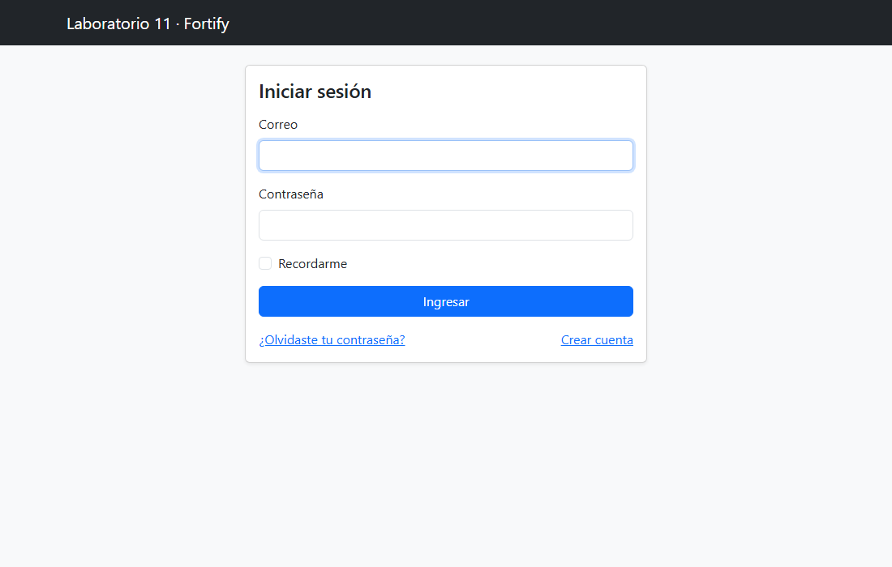

En `/password/reset` se escribe el correo de la cuenta para solicitar el enlace de restablecimiento de contraseña.

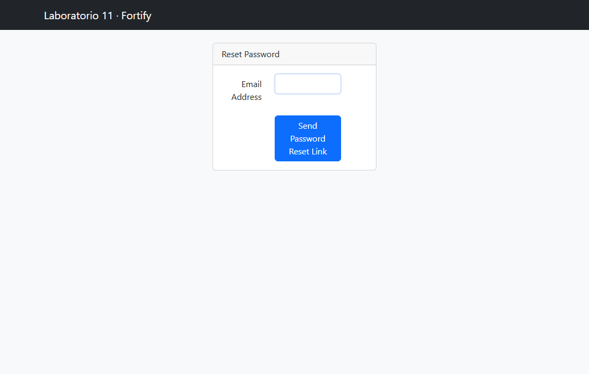

### 7.2 Actividad 2: Laravel Breeze

Pantalla de registro de Breeze (`/register`). El usuario ingresa sus datos y envía el formulario.

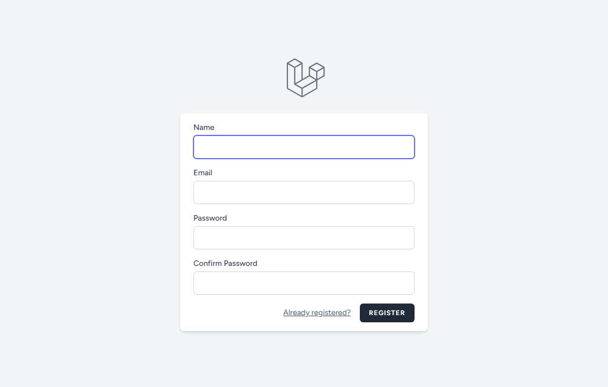

Como el modelo `User` implementa `MustVerifyEmail`, Breeze muestra el aviso para verificar el correo, con la opción de reenviar el enlace.

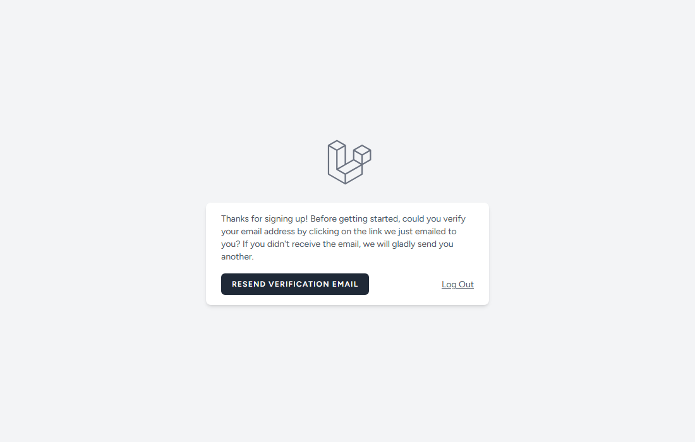

Con `MAIL_MAILER=log` el correo no se envía: se guarda en `storage/logs/laravel.log`, de donde se toma el enlace de verificación.

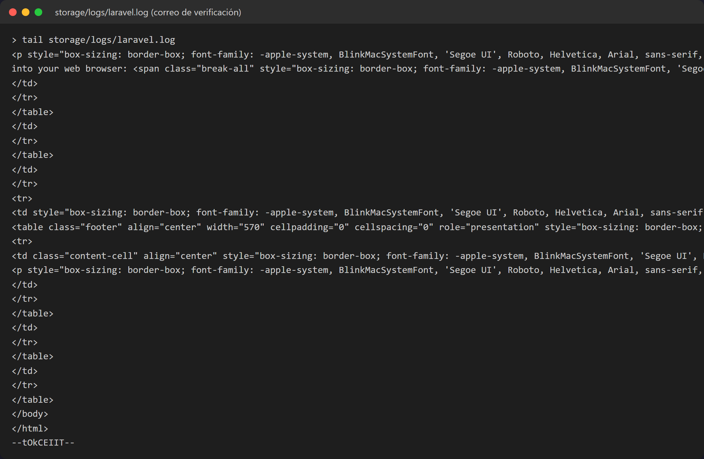

Al abrir el enlace de verificación, el correo queda verificado y Breeze permite entrar al `dashboard`, que exige los middleware `auth` y `verified`.


Desde `/profile` el usuario puede editar su nombre y correo, cambiar la contraseña o eliminar su cuenta.

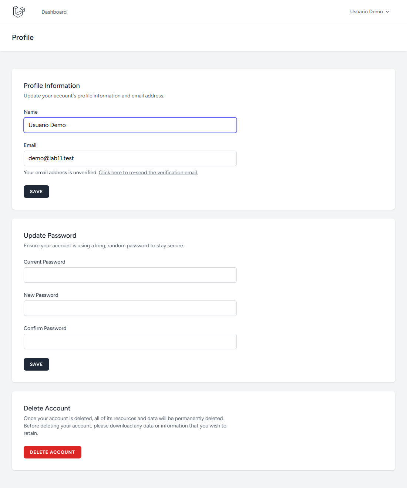

Pantalla de login de Breeze (`/login`).

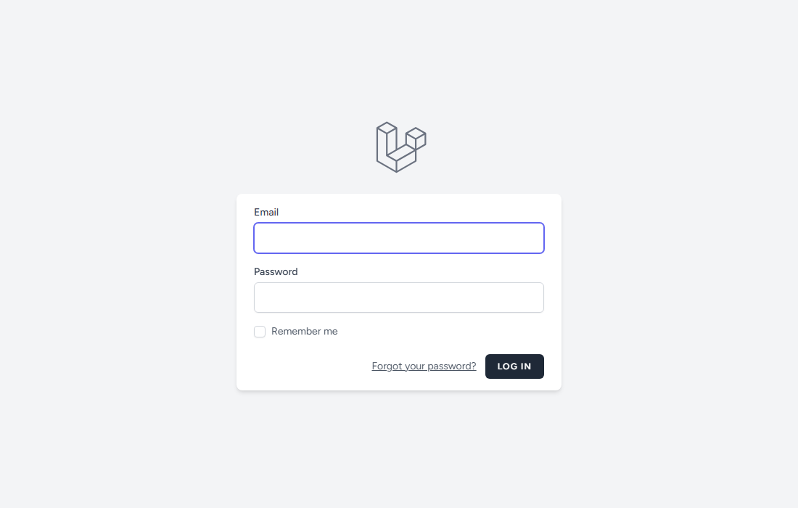

Formulario `/forgot-password` para solicitar el enlace de restablecimiento. El correo también queda en `laravel.log`.

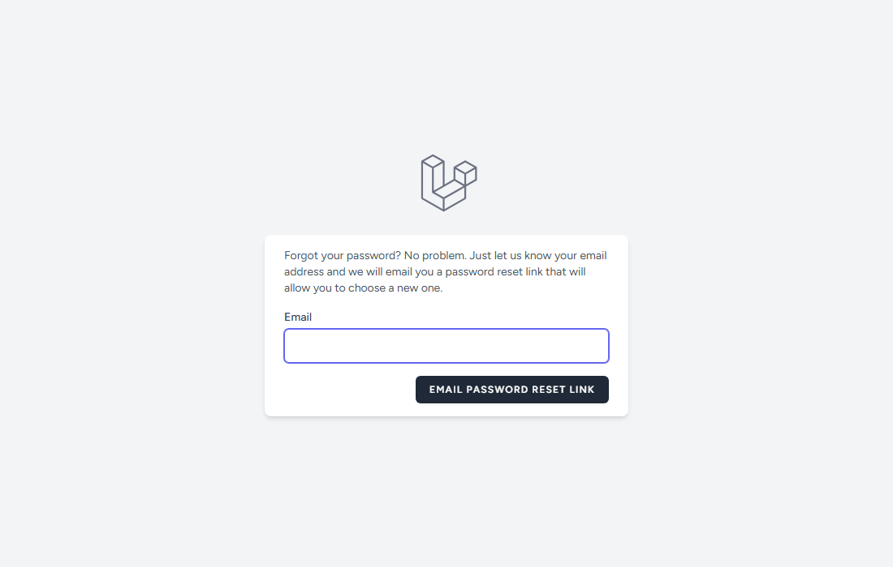

### 7.3 Actividad 3: Laravel Socialite

Se agregaron al login de Breeze los enlaces «Iniciar sesión con Facebook», «Twitter» y «Google». Cada uno llama a la ruta `social.redirect` con el nombre del proveedor.

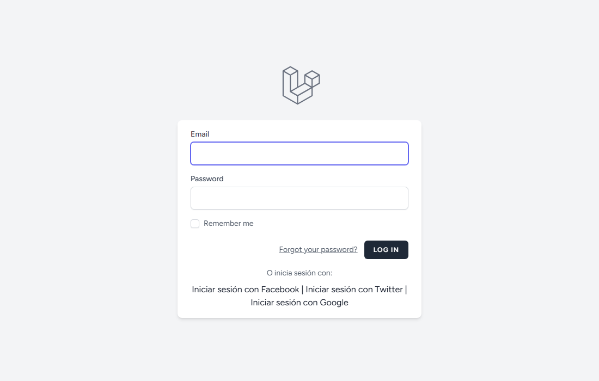

Como el inicio de sesión real requiere claves de cada red social, se comprobó la redirección con `curl`: `/login/google` y `/login/facebook` responden `HTTP 302` con un `Location` que apunta a Google y a Facebook. El resto del flujo se comprobó con la prueba automatizada de la sección 6.3.

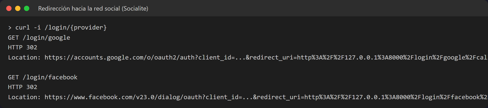

### 7.4 Actividad 4: Laravel Passport

Passport protege una API y no tiene pantallas, por lo que se probó enviando solicitudes HTTP a `routes/api.php`.

`POST /api/register` crea el usuario y devuelve sus datos con un token de acceso (respuesta 201).

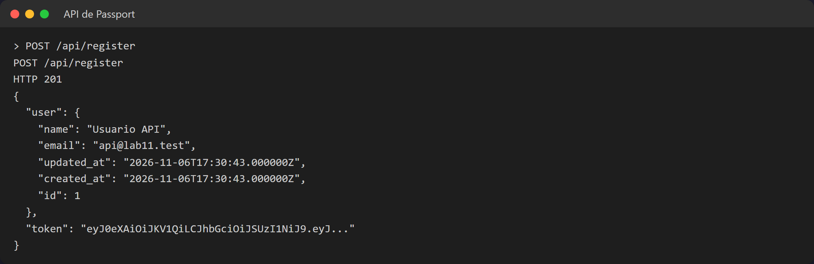

`POST /api/login` valida las credenciales y devuelve un token (respuesta 200).

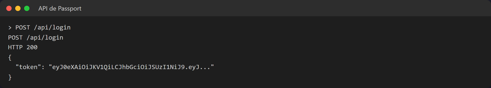

`GET /api/user` con el encabezado `Authorization: Bearer <token>` devuelve los datos del usuario autenticado.

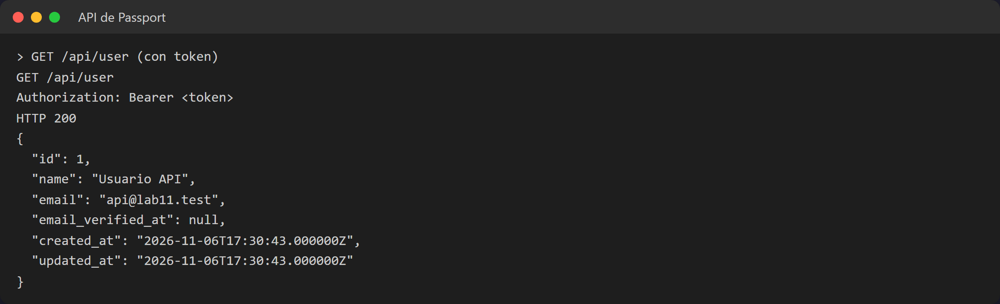

La misma solicitud sin token responde 401 «Unauthenticated», porque el middleware `auth:api` protege la ruta.


### 7.5 Actividad 5: Laravel Fortify

Formulario de registro con la vista creada en el laboratorio. Fortify aporta el backend: el formulario envía los datos a `POST /register`.


Tras registrarse, el usuario llega a `/home`, donde aparece el botón para activar la autenticación en dos pasos (2FA).


Al pulsar «Activar 2FA», Fortify pide confirmar la contraseña, por ser una acción sensible.


Fortify genera el secreto de 2FA y la vista muestra el código QR para escanear con una aplicación autenticadora, el campo del código de 6 dígitos y los códigos de recuperación.


Con el código correcto, la 2FA queda activada y confirmada. Los códigos de recuperación sirven si se pierde el acceso al celular.


Al volver a `/login` se ingresan el correo y la contraseña.


Como el usuario tiene 2FA, Fortify muestra la verificación en dos pasos, donde se pide el código de la aplicación autenticadora o uno de recuperación.


Con el código válido se completa el inicio de sesión y se accede a `/home`, con la 2FA activa.


Formulario `/forgot-password`, servido por Fortify, para pedir el enlace de restablecimiento.


---

## 8. Conclusiones

- La autenticación en Laravel se apoya en **guards** y **providers** definidos en `config/auth.php`: el guard `web` (sesión) atiende al navegador y el guard `api` (Passport) atiende a los clientes de la API, sobre el mismo modelo `User`.
- **Laravel UI** y **Breeze** entregan, con dos comandos, un sistema completo de login, registro y recuperación de contraseña; Breeze genera el código dentro de la aplicación, lo que facilita personalizarlo.
- **Socialite** evita crear y mantener contraseñas: delega la identidad en la red social, y solo hace falta un controlador de dos métodos (`redirect` y `callback`) y las credenciales en `.env`.
- **Passport** permite autenticar clientes de API mediante tokens OAuth2; requiere migraciones, `passport:install`, el trait `HasApiTokens` y un guard `api` con el driver `passport`. Para casos simples, Sanctum es una alternativa más ligera.
- **Fortify** resuelve todo el backend de la autenticación (incluida la autenticación en dos pasos) sin imponer un front-end, a costa de que el desarrollador cree sus propias vistas.
- Como UI, Breeze y Fortify usan las mismas rutas de acceso, no pueden convivir activos en la misma aplicación; trabajar con una rama de git por actividad permitió desarrollar todas en un único proyecto sin que se pisaran.

---

## 9. Repositorio

Código fuente completo en este repositorio. Cada actividad está en su propia rama de git (`act1-laravel-ui`, `act2-breeze`, `act3-socialite`, `act4-passport`, `act5-fortify`); los archivos de código comentados de cada actividad están además en `codigo/`.
